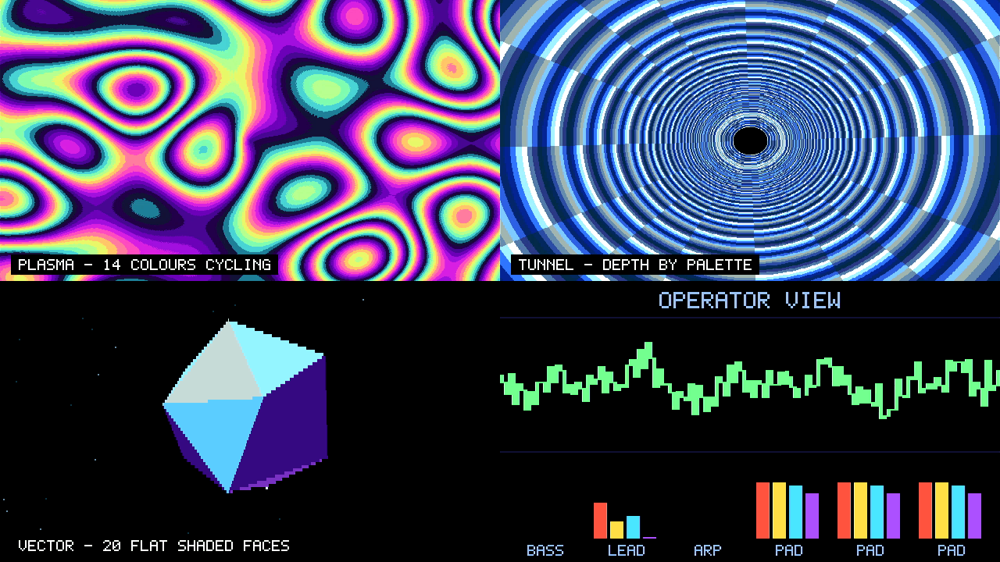
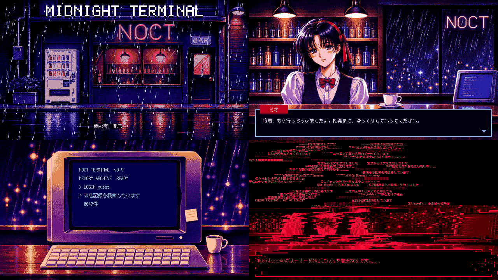

# KAGURA-HD

Tang Nano 9K（GW1NR-9C）向けのフレームバッファ型グラフィックスエンジンです。RP2040などのSPI/QSPIホストからPSRAM上の画面を更新し、HDMIへ映像と音声を出力します。

## Demo

### FOUR OPERATORS — 16色メガデモ

[](https://youtu.be/iypg81KaGmQ?si=ItaV4tVjuPjqaDHs)

▲ 画像をクリックするとYouTubeで実機動画が再生されます。

[](software/fm_megademo/README.md)

RP2040の2つ目のコアで動くソフトウェアFM音源（4オペレータ×6声）を、PCMストリーミングでHDMIへ流す132秒のメガデモです。画面はFILL・COPY・PALETTE・PRESENT・WRITEだけで描いています。実機で完走し、録音した音声の欠落は0でした。[詳細と実機結果](software/fm_megademo/README.md)。

### MIDNIGHT TERMINAL — FM EDITION

[](https://youtu.be/ocwRtPimfRQ)

▲ 画像をクリックするとYouTubeで実機動画が再生されます。

[](software/midnight_terminal/README.md)

雨の夜のバーで店員ミオと言葉を交わし、古い端末を覗きこむ104秒の短編です。曲と効果音はすべてFM音源で合成しています。実機で完走し、音声の欠落は0でした。[詳細と実機結果](software/midnight_terminal/README.md)。

### そのほか

- [BEYOND 16 COLORS](software/beyond16/README.md)：150秒・全8シーンのデモ。選定版でも回帰試験を行い、完走を確認しています。[実機結果](software/beyond16/HARDWARE_RESULT.md)
- [6シーンのMicroPython Showcase](software/kagura_fb/showcase/README.md)

実機試験では、FPGAへは選定版をSRAMに一時投入しています（電源を切ると元のFlashの構成に戻ります）。RP2040のFlashへ書き込んだ試験では、終了後に元の内容へ書き戻し、一致を確認しています。

## すぐに試す

[Releases](https://github.com/siska-tech/kagura-hd/releases/latest)に、選定版bitstreamと2つのデモのUF2を置いています（2026-11-09の[v2026.11.09.1](https://github.com/siska-tech/kagura-hd/releases/tag/v2026.11.09.1)から、SPI版のbitstreamとUF2も添付）。ビルド環境は要りません。

1. Tang Nano 9Kに`kagura-hd-qspi-pcm-stream.fs`を書き込みます（Gowin Programmerの「embFlash Erase,Program」など）。SecurityBitがONのため、Verify付きの操作は失敗します。1.9.11.03で書込みを確認しました。
2. Raspberry Pi Pico（RP2040）を[配線表](docs/kagura-fb-host-api.md#配線転送)のとおりにつなぎ、GNDを共通にします。
3. PicoのBOOTSELボタンを押しながらUSBをつなぎ、現れたドライブ`RPI-RP2`へ`four-operators.uf2`か`midnight-terminal.uf2`をコピーします。
4. Tang Nano 9KのHDMIを、720p60と音声に対応した表示機へつなぎます。

Picoは起動から約5秒後に、自動でデモを始めます。もう一度見るときは、Picoの電源を入れ直してください。UF2を書き込むと、Picoにそれまで入っていたプログラムは消えます。起動から5秒以内にシリアル端末でPicoのUSBポートを開くと、従来どおり`g`の入力を待ってから始まり、終了時に結果を表示します。

**SPIで使う場合（任意）。** QSPIを使えないHost向けに、SPI版もあります。配線は同じで、IO2とIO3は使いません。手順1で`kagura-hd-spi-pcm-stream.fs`を、手順3で`four-operators-spi.uf2`か`midnight-terminal-spi.uf2`を使ってください。FPGAとUF2は、必ずSPI同士、QSPI同士で組み合わせます。SPIの既定は5 MHzです。


## Bitstream

2026-11-08、PCMストリーミングに対応したQueue8・QSPI版を選定版にしました（従来のPCM2版を置き換え）。[パッケージと検証記録](releases/pcm-stream-qspi/README.md)、[Release添付一覧](releases/README.md)を参照してください。

2026-11-09には、同じ機能のSPI版も配布対象にしました（[パッケージと検証記録](releases/pcm-stream-spi/README.md)）。QSPIとSPIはビルド時にどちらか一方を選び、実行時の切替えはしません。SPI版は、STAを通すためにSPIだけの差し替えRTL（[rtl/spi/](rtl/spi/README.md)）を使います。QSPI版のbitstreamと入力は変わりません。SPIの既定は5 MHzです。8 MHzは任意の高速設定で、動作を保証する周波数ではありません。10 MHz以上は非対応です。SPI版は[v2026.11.09.1](https://github.com/siska-tech/kagura-hd/releases/tag/v2026.11.09.1)からGitHub Releaseに添付しています。


|項目|内容|
|---|---|
|Bitstream|[kagura-hd-qspi-pcm-stream.fs](artifacts/validated/kagura-hd-qspi-pcm-stream.fs)（QSPI、選定版）／[kagura-hd-spi-pcm-stream.fs](artifacts/validated/kagura-hd-spi-pcm-stream.fs)（SPI）|
|SHA-256|QSPI `fad1537627f969abf3181eebc14ce18e252a740e99ab57f4f5abb46a4286b7db`／SPI `e9f67c683df4ab9c5f9ee382433d0a46f101578dbdcf66684da14992ce8c1767`|
|FPGA / Tool|GW1NR-LV9QN88PC6/I5 / Gowin Standard V1.9.12.04|
|Host|QSPI（またはSPI版ではSPI）Mode 0、MSB先行、`KFB1` / ABI **1.4** / CAPS `FF`、Queue8、PCMストリーミング拡張（audio index `E3`=`0x51`）|
|映像|640×360、4bpp、16色RGB444パレット。整数2倍で1280×720・60Hz HDMI出力|
|画面メモリ|PSRAM、2ページ。PRESENTで垂直帰線中にページとパレットを反映|
|描画|FILL、READ/WRITE、overlap・ページ間対応の不透明COPY_RECT（BLIT）|
|BLIT制約|Xと幅は偶数、送受Xの差は8画素の倍数|
|カーソル|32×32・2bpp、透明色＋独立3色、形状2バンク、垂直帰線で反映|
|音声|signed8 PCM **2ch**、48kHz、左右GAIN・MASTER、HDMI stereo出力。PSRAM上のA/B半面をHostが連続補充するストリーミング|
|SDK|[C](software/kagura_fb/kagura_fb.h)、[MicroPython Device](software/kagura_fb/kagura_fb.py)、[PCM Audio](software/kagura_fb/kagura_fb_audio.py)|

音声はPCM2（ワンショットとループ）と、Hostが半面ずつ補充するストリーミングに対応しています。旧6ch音源のHost設定は使いません。描画、カーソル、BLITはABI 1.2を引き継ぎ、音声CSR、COMMIT、ストリーミングCSRを追加しています。[Host ABI・音声契約](docs/kagura-fb-host-api.md)を参照してください。

## 確認範囲

選定版の内部STAはSetup **+0.177ns**、Hold **+0.527ns**、Setup/Hold違反 **0/0**です。実機試験はnominal PIO QSPI 5MHzの有限試験で、最大通信速度、外部PSRAM I/Oの全PVT適合、全画面のbyte一致、長時間・複数基板の保証は含みません。SPI版の内部STAはSetup **+0.159ns**、Hold **+0.456ns**、違反 **0/0**です。SPI 5 MHzで3デモを完走し、5〜8 MHzのクロックスイープも行いました。範囲はQSPIと同じく有限の試験です（[SPIの確認範囲](releases/pcm-stream-spi/README.md)）。旧PCM2のSPI実験物（STA不合格）は[experimental](artifacts/experimental/spi-sta-fail/README.md)に記録として残しています。過去の評価JSONの`release_ready=false`は当時のゲート結果として保持します。[公開準備状況と制限](docs/release-validation.md)。

## ビルドと検証

選定版は、実機で認定したBitstreamをそのまま固定しています。再ビルドしても採用ファイルを上書きしません。元のビルド入力41ファイル、P&R設定、SHA-256、再現スクリプトを[成果物ディレクトリ](releases/pcm-stream-qspi/)に保存しました（旧PCM2版は[pcm2-qspi-final](releases/pcm2-qspi-final/)）。選定版は2段階で作ります。まずP4/R2で合成し、そのnetlistをP3/R2/maxfan 23で配置配線し直します。同じ手順で再現できることは、`releases/pcm-stream-qspi/reproduce.ps1` で確認できます。

Windows、Gowin Standard V1.9.12.04、Python 3で、リポジトリルートから実行します。

```powershell
python tools/check-release.py
./tools/check-dependencies.ps1
./tools/build-fb.ps1 -Transport qspi
```

`-GowinExe 'C:/path/to/IDE/bin/gw_sh.exe'`で配置先を指定できます。出力は`build/kagura-fb-qspi/impl/pnr/kagura_fb.fs`です。この通常のビルドは、選定版とは配置配線が異なります（STAの検査は Setup ≥0.100ns、Setup/Hold違反0）。選定版そのものを再現するときは、上の`reproduce.ps1`を使ってください。[入力とビルド手順](docs/standard-build.md)。

WSL/LinuxではPython 3、C11、g++、make、Verilator **5.032**、bash、flock、timeoutを使用します。

```sh
python3 tools/check-release.py
KAGURA_STRICT_VERSION=1 KAGURA_SEED=1 bash tools/test-fb-verilator.sh
KAGURA_STRICT_VERSION=1 KAGURA_SEED=1 bash tools/test-common-verilator.sh
bash tools/test-fb-audio-qspi.sh
bash tools/test-fb-wrap32.sh
bash tools/test-fb-wrap32-integration.sh
bash tools/test-fb-drivers.sh
# 任意：Unix MicroPython v1.26.0
MICROPYTHON=/path/to/micropython bash tools/test-fb-micropython.sh
```

[公開前の回帰](docs/release-preparation-validation.md)では、CIと同じシミュレーションとドライバ試験を、選定版のRTLで手元で再実行し、すべて合格しました（2026-11-09）。[CI](.github/workflows/kagura-fb.yml)でもRTL・SDK・公開成果物を検証します。実機試験の再実行には配線・復旧手順と各Demoの手順を使用してください。

## 資料と出典

[資料案内](docs/README.md)、[配線・Host API](docs/kagura-fb-host-api.md)、[BLIT](docs/kagura-fb-blit.md)、[カーソル](docs/kagura-fb-cursor.md)、[整理内容](docs/cleanup.md)を参照してください。`artifacts/validated/`は実機確認済みQSPI、`artifacts/experimental/spi-sta-fail/`は書込み禁止のSPI実験物です。`build/`は作業用・録画・退避物で、公開対象から除外しています。日付付き文書は各時点の開発履歴です。

公開先は[siska-tech/kagura-hd](https://github.com/siska-tech/kagura-hd)。Kagura-9の`f562b2ec84605860fdb9f701f5b2e197b5ed4432`を基盤とし、内部RTL名`kagura_fb_*`と既存SDKパスを継承しています。本体は[Apache-2.0](LICENSE)。[NOTICE](NOTICE)、[THIRD_PARTY](THIRD_PARTY.md)、[出典](docs/sources.md)の表記を保持します。第三者コードと生成IPの条件はそれぞれの許諾に従います。
